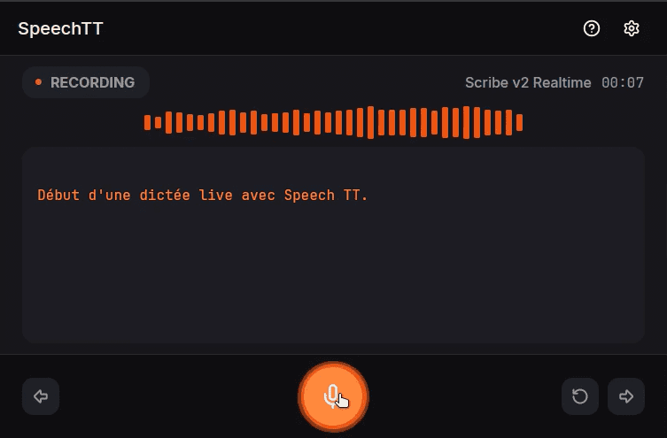

# SpeechTT — a floating speech-to-text widget

SpeechTT is a small floating desktop widget that turns your voice into text:
press the record button, watch the waveform and the transcript fill in live, then
copy or save the result. It is one native Rust process rendered with `gpui-kit`,
with a stateless Bun worker doing the speech-to-text behind a local pipe.

## Demo

[](https://github.com/user-attachments/assets/6368304a-95e1-4701-9b4a-b19ce5365059)

## Download

The latest Linux build is on the
[Releases page](https://github.com/zipang/spechtt/releases/latest). Download the
AppImage for your architecture, then run it:

```sh
chmod +x SpeechTT-*-x86_64.AppImage
./SpeechTT-*-x86_64.AppImage
```

The AppImage contains the widget and the STT worker, but it is **not**
self-contained. It still requires:

- `bun` ≥ 1.4.0 on `PATH` — the bundled worker runs on it.
- `ffmpeg` and `ffprobe` for **file transcription only** — live dictation does
  not use them.
- A working graphical session with a Vulkan driver — GPUI renders through it.

A desktop launcher starts the app directly instead of through a shell, so it
inherits neither `~/.bashrc`, `~/.zshrc` nor the `PATH` they build. A terminal
may therefore find `bun` while the AppImage started from a menu does not. The
app also looks in `~/.bun/bin/bun`, `/usr/local/bin/bun` and
`/opt/bun/bin/bun`. If `bun` lives somewhere else, open **Settings** and fill the
**Bun path** row — the widget opens Settings by itself when it cannot start the
worker, and saving the path starts it without restarting the app. To fix the
environment instead, export `PATH` for the graphical session from
`~/.config/environment.d/bun.conf` (for example
`PATH=$HOME/.bun/bin:$PATH`), then log out and back in.

The download is the short path; [Getting started](#getting-started) still covers
building from source.

## What it does

- **Live dictation** — records the default microphone, animates a waveform from
  the input spectrum and streams the transcript into the widget while you speak.
  Pause, resume and stop from the transport controls.
- **File transcription** — pick an audio or video file and get the same
  transcript screen, with decode progress instead of a live waveform.
- **Gateway models** — one provider, the Vercel AI Gateway, exposes a catalogue
  of transcription models (ElevenLabs, Mistral, OpenAI, Google and others) that
  you choose in Settings.
- **Window-scoped shortcuts** — `Space`, `Enter`, `Ctrl`/`Cmd`+`S`, `F1` and `F2`
  act only while the widget, or one of its dialogs, holds focus, and only in the
  state where they can act. No keystroke is taken from another application.
- **Single process** — the widget, the domain logic and the worker bridge live
  in one binary; there is no daemon and no background service.

## Requirements

| Component                     | Needed for                  | Notes                                                                                                                       |
| ----------------------------- | --------------------------- | --------------------------------------------------------------------------------------------------------------------------- |
| Linux, macOS or Windows       | everything                  | Linux is the primary platform; macOS and Windows are best effort.                                                           |
| Rust 1.92 or later            | building                    | Install with [rustup](https://rust-lang.org/tools/install/).                                                                |
| `bun` ≥ 1.4.0                 | live and file transcription | Runs the STT worker as a child process.                                                                                     |
| `ffmpeg` ≥ 6.0 with `ffprobe` | **file transcription only** | Live dictation needs `bun` alone; `ffmpeg` decodes the picked file.                                                         |
| `SpeechTT-*-x86_64.AppImage`  | running without a build     | Linux only. Still needs `bun` on `PATH`, `ffmpeg`+`ffprobe` for file transcription, and a Vulkan-capable graphical session. |
| A Vercel AI Gateway key       | transcription               | `AI_GATEWAY_API_KEY` or `VERCEL_AI_GATEWAY_API_KEY`.                                                                        |

Verify and install the two runtime binaries with one command per platform:

```text
Linux (primary), macOS and Windows (best effort)
  bun >= 1.4.0, ffmpeg >= 6.0 (provides ffprobe)

Verify:      ./scripts/setup.sh --check      (Windows: .\scripts\setup.ps1 -Check)
Install:     ./scripts/setup.sh              (Windows: .\scripts\setup.ps1)
```

Both bootstraps print a status table and show the exact commands they would run,
marking the steps that need root, then ask before changing anything. `--check`
(`-Check`) only reports, `--dry-run` (`-DryRun`) prints the plan without running
it, and `--yes` (`-Yes`) skips the question — the first two never prompt, not
even to install a missing `bun`. The script never guesses a package manager: on
an unknown system it prints the manual install instructions instead.

## Getting started

### 1. System packages and the Rust toolchain

Linux needs the windowing, audio and font libraries that `gpui-kit` links
against. The list below is the one GPUI Kit verifies on Ubuntu 24.04 — see
[GPUI Kit's installation guide](https://gpui-kit.com/docs/installation) for the
macOS and Windows steps and for other distributions:

```sh
sudo apt update
sudo apt install -y gcc g++ clang libfontconfig-dev libwayland-dev \
  libwebkit2gtk-4.1-dev libxkbcommon-x11-dev libx11-xcb-dev \
  libssl-dev libzstd-dev libasound2-dev vulkan-validationlayers libvulkan1
```

Install Rust 1.92 or later with [rustup](https://rust-lang.org/tools/install/),
then check the tools in the terminal you will build from:

```sh
rustc --version
cargo --version
```

### 2. Runtime dependencies

```sh
./scripts/setup.sh --check   # what is installed, what is not
./scripts/setup.sh           # install what is missing, after confirmation
```

On Windows use `.\scripts\setup.ps1 -Check` and `.\scripts\setup.ps1`. The same
commands are available through Bun as `bun run setup --check` and
`bun run setup`; `--dry-run` prints the plan without running it, and `--yes`
skips the confirmation prompt.

The bootstrap installs `bun` itself when it is absent, then hands the flags to
`scripts/setup.ts`, which owns the probing, the plan and the exit codes.

### 3. Build and run

Clone the repository, then run every command from its root, where
`bun install` and the source tree live:

```sh
git clone https://github.com/zipang/spechtt.git
cd spechtt
bun install
bun run ui
```

`bun run ui` builds and starts the widget (`cargo run -p speechtt-ui`). The first
build compiles GPUI and takes several minutes; later starts are quick. To quit,
close the widget's window; `Ctrl`+`C` in that terminal stops the process too.

## First run — an API key

The widget transcribes through the Vercel AI Gateway, so it needs one gateway
key. Provide it in either of two ways:

- **Environment** — export `AI_GATEWAY_API_KEY` (or
  `VERCEL_AI_GATEWAY_API_KEY`) before starting the widget.
- **Settings** — press `F2` and paste the key into the Settings dialog. It is
  stored in `~/.config/speechtt/settings.json`
  (`$XDG_CONFIG_HOME/speechtt/settings.json` when that variable is set), which is
  written with mode `0600`, owner-only.

Once a key is stored, the UI only ever shows it masked: its first three
characters, an ellipsis and its last two, or a fixed `••••` when the key is
shorter than eight characters. The key is redacted from diagnostics — the
`Authorization`, `Bearer`, `sk-…` and `key=…` forms are replaced before a
message is written — and it is never logged in clear.

Then choose a model in Settings and start dictating with `Space`, or pick a file
from the mode chooser.

## Keyboard shortcuts

| Action                                 | Shortcut                        |
| -------------------------------------- | ------------------------------- |
| Start · pause · resume recording       | `Space`                         |
| Stop recording and show the transcript | `Enter`                         |
| Save transcript to a file              | `Ctrl`+`S` (`Cmd`+`S` on macOS) |
| Open or close Help                     | `F1`                            |
| Open or close Settings                 | `F2`                            |

`Ctrl`+`C` (`Cmd`+`C` on macOS) copies the selected transcript text. It is bound
in the same place as the table above but is not one of its rows, so it does not
appear in the Help dialog. That dialog's Shortcuts tab is generated from the same
binding table the application registers, so its rows and the keymap cannot
disagree. The set is fixed: there is no rebinding.

## Project layout

A selected view of the tree rather than an exhaustive one: every Rust module and
every worker module is listed, while unit-test siblings (`*.spec.ts` beside each
`src/stt` source, `tests/` inside each crate) are named by their folder. The
design files are referenced by the MCP mockups, not loaded by the binary.

```text
speechtt/
├── Cargo.toml                       # Cargo workspace (edition 2024)
├── package.json                     # Bun scripts: setup, package, design checks, UI run/build/test
├── AGENTS.md                        # Engineering rules, quality gates, module boundaries
├── PRODUCT.md                       # Vision, users, functional requirements
├── DESIGN.md                        # Design-system contract
├── design-tokens.css                # Source of truth for colours, type, spacing, radii
├── color-variants.css               # Derived muted/active variants for brand & action colours
├── reset.css                        # Base reset over the theme variables
├── skills-lock.json                 # Pinned versions of the installed agent skills
├── demo-launcher-vignette.png       # Poster frame for the demo video above
│
├── crates/
│   ├── speechtt-core/               # Framework-free domain logic (no GPUI dependency)
│   │   ├── src/lib.rs               # Public module surface
│   │   ├── src/session.rs           # Session state machine (Blank/Ready/Recording/Paused)
│   │   ├── src/actions.rs           # The keyboard command vocabulary
│   │   ├── src/audio.rs             # Microphone capture → 16 kHz mono i16 frames
│   │   ├── src/fft.rs               # Spectrum analysis for the waveform
│   │   ├── src/backend.rs           # NDJSON bridge and the Bun subprocess
│   │   ├── src/protocol.rs          # Wire protocol shared with the worker
│   │   ├── src/transcript.rs        # Streaming transcript reducer
│   │   ├── src/output.rs            # Clipboard, paste and save-to-file adapters
│   │   ├── src/settings.rs          # Typed settings and their JSON file
│   │   ├── src/media.rs             # Which files may be transcribed
│   │   └── tests/                   # session_machine, transcript_captures, bridge_smoke + fixtures
│   │
│   └── speechtt-ui/                 # Native gpui-kit application
│       ├── src/main.rs              # Binary entry point → speechtt_ui::run()
│       ├── src/lib.rs               # run(), window-bounds helpers, embedded icons and assets
│       ├── src/startup.rs           # The startup seam: everything installed before the window
│       ├── src/app.rs               # Window shell, commands, dialog routing
│       ├── src/controller.rs        # Pure view model (no GPUI window)
│       ├── src/layout.rs            # ScreenShell and SurfaceBox
│       ├── src/shortcuts.rs         # Key bindings and the Help dialog's rows
│       ├── src/diagnostics.rs       # Redacted single-line diagnostics for typed errors
│       ├── src/theme.rs             # Token → gpui-kit theme mapping and bundled fonts
│       ├── src/tokens.rs            # Rust mirror of design-tokens.css
│       ├── src/views/               # One screen per file: welcome, session_setup, recording,
│       │                            #   session_transcription, session_end, dialogs/
│       ├── src/components/          # Reusable controls: buttons, badges, waveform, caption well…
│       ├── assets/fonts/            # Inter + JetBrains Mono faces and their OFL licences
│       └── tests/                   # design_system, dialogs, end_to_end, error_ux, launch,
│                                    #   session_flow, shortcuts, startup, theme_contract, widget
│
├── src/stt/                         # Bun STT worker: stdout is NDJSON, stderr is diagnostics
│   ├── worker.ts                    # Subprocess entry point
│   ├── protocol.ts                  # Wire protocol, mirrored in speechtt-core
│   ├── registry.ts                  # Provider and model capability registry
│   ├── stream-controller.ts         # NDJSON audio → AI SDK stream
│   ├── adapters/                    # vercel-ai-sdk.ts, mistral.ts, file.ts, types.ts
│   ├── discovery.ts                 # Live model discovery through the gateway
│   ├── file-input.ts                # ffmpeg/ffprobe decoding for file transcription
│   ├── segmentation.ts              # Silence-aligned segmentation for batch models
│   ├── transcript-merge.ts          # Junction-safe transcript merging
│   ├── clean.ts                     # Language-model cleanup of a finished transcript
│   ├── languages.ts                 # Dictation languages offered in the widget
│   ├── diagnostics.ts               # Failure descriptions for adapters and the worker loop
│   └── trace.ts, trace-analyze.ts   # Opt-in dump of provider events, and its analysis
│
├── scripts/
│   ├── setup.ts, setup.spec.ts      # Dependency probe, plan and installer, with their tests
│   ├── package.ts, package.spec.ts  # AppImage build, staging and checksum, with their tests
│   ├── setup.sh, setup.ps1          # Thin bootstraps for Unix shells and PowerShell
│   ├── validate-design.ts           # DESIGN.md + design-tokens.css contract check
│   └── sync-contrast.ts             # Regenerates colour variants and contrast pairs
├── packaging/                       # AppImage icon source and its rendered 256×256 PNG
├── tests/                           # Bun tests for the design contract, plus a gateway helper
├── mockups/                         # Reference renders exported from Paper (never imported)
├── vendor/design-tokens/            # Vendored design-token validator and contrast helpers
├── tickets/                         # The Kanban board: planned, in_progress, review, done
├── .agents/skills/                  # Agent skills installed for this repository
├── bun.lock                         # Bun dependency lockfile
├── Cargo.lock                       # Rust dependency lockfile
└── LICENSE                          # MIT licence, shipped in the AppImage
```

### What lives where

- **`crates/speechtt-core`** — the behavioural backbone. Pure Rust with no GPUI
  dependency, so the session rules, the audio pipeline, the wire protocol, the
  transcript reducer and the output adapters are testable headlessly.
- **`crates/speechtt-ui`** — everything native and visual. `controller.rs` owns
  the pure view model, `app.rs` the window shell and command surface, `views/`
  composes each screen from the components, and `theme.rs` maps the token
  contract onto `gpui-kit` with the fonts embedded in the binary.
- **`src/stt/`** — the stateless worker. It reads NDJSON commands on `stdin`,
  writes NDJSON events on `stdout` and keeps `stderr` for human diagnostics.
- **`scripts/`** — dependency bootstrap, AppImage packaging and design-system
  tooling, run with Bun. They are development tools and never ship inside the
  widget.
- **Root design files** — `design-tokens.css` is the single source of truth for
  visual values and `DESIGN.md` describes their intent; `color-variants.css` and
  `reset.css` support the reference renderings and load after it. The binary
  reads the mirrored Rust tokens (`tokens.rs`), never these stylesheets, and no
  call site may hardcode a token value.
- **`mockups/` + `vendor/`** — reference and tooling only; neither is imported at
  runtime.

Build artifacts (`target/`, `node_modules/`) are generated and git-ignored.

## Development

Every gate must be green with zero warnings:

```sh
cargo fmt -- --check
cargo clippy --all-targets -- -D warnings
cargo test
bun test
bun check src/stt
bun check scripts/package.ts scripts/package.spec.ts
bun run design:validate
```

`cargo test` carries two gates that are easy to overlook:

- **startup** (`crates/speechtt-ui/tests/startup.rs`) runs the `startup::init_app`
  seam headlessly, so every keymap registration is parsed before a user starts
  the widget, and checks that `run()` wires the seam instead of registering
  anything itself.
- **launch** (`crates/speechtt-ui/tests/launch.rs`) starts the built binary
  headless — with `DISPLAY` and `WAYLAND_DISPLAY` removed, so no window opens on
  the developer's desktop — and fails if the widget exits before it reports
  `[speechtt] startup status=window-open` or within the settle window after it.
  It needs no display server, no audio server and no user configuration.

Tests are hermetic: they inject fakes for audio, clipboard, input, the STT
backend and the package managers, so no suite needs a microphone, a display, the
network or a real user configuration directory. Write the failing test first.

## Releasing

A release is one command, run from the repository root:

```sh
bun run package
```

The script advances the patch version in the `[workspace.package]` table of
`Cargo.toml` **before** it builds: a rebuild is a patch-level change, and the
minor number is reserved for a feature line a human decides on. It then reads
the version back from `cargo metadata`, so the AppImage file name and the
version the widget reports (`V<version>` in the header and in the Help footer)
come from the same number.
It bundles the worker, builds the release widget, stages and packages the
AppDir, writes `dist/SpeechTT-<version>-<arch>.AppImage` with its `.sha256`
companion, and prints the `gh release create` command. Commit `Cargo.toml` and
`Cargo.lock` with the release; the script itself never runs `git` or `gh`.

A build that fails after the bump restores `Cargo.toml`, so retrying after an
error does not consume a second version.

Opt out explicitly when the run is not a release:

- `--no-bump` builds and packages the current version without advancing it, for
  example while checking a change to the packaging script.
- `--no-build` repackages the existing binary and worker and never bumps,
  because a new number would name an artifact whose binary reports the old one.
  Without `--no-bump` it prints one line saying the bump was skipped.
- `--dry-run` prints the release version and the full plan, and writes nothing.

## Documentation map

| Document                                 | What it answers                                                        |
| ---------------------------------------- | ---------------------------------------------------------------------- |
| [`PRODUCT.md`](PRODUCT.md)               | Vision, users, functional requirements, provider plan, open questions  |
| [`DESIGN.md`](DESIGN.md)                 | The design-system contract: token roles, component states, usage rules |
| [`AGENTS.md`](AGENTS.md)                 | Architecture, module boundaries, engineering rules, quality gates      |
| [`tickets/README.md`](tickets/README.md) | The Kanban board: how work is specified, tracked and reviewed          |

## Status

SpeechTT builds and runs as a single desktop application: the session workflow,
live dictation, file transcription, the gateway adapter, settings persistence,
the output adapters and the window-scoped shortcuts are implemented and covered
by the suites listed above. Remaining work — further UI polish, packaging and the
open product decisions — is tracked on the Kanban board in
[`tickets/`](tickets/README.md), which is the authoritative record of what is
planned, in progress and done.
